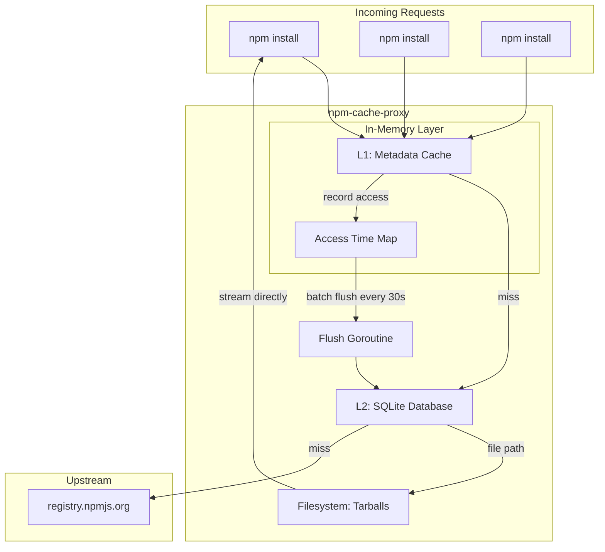
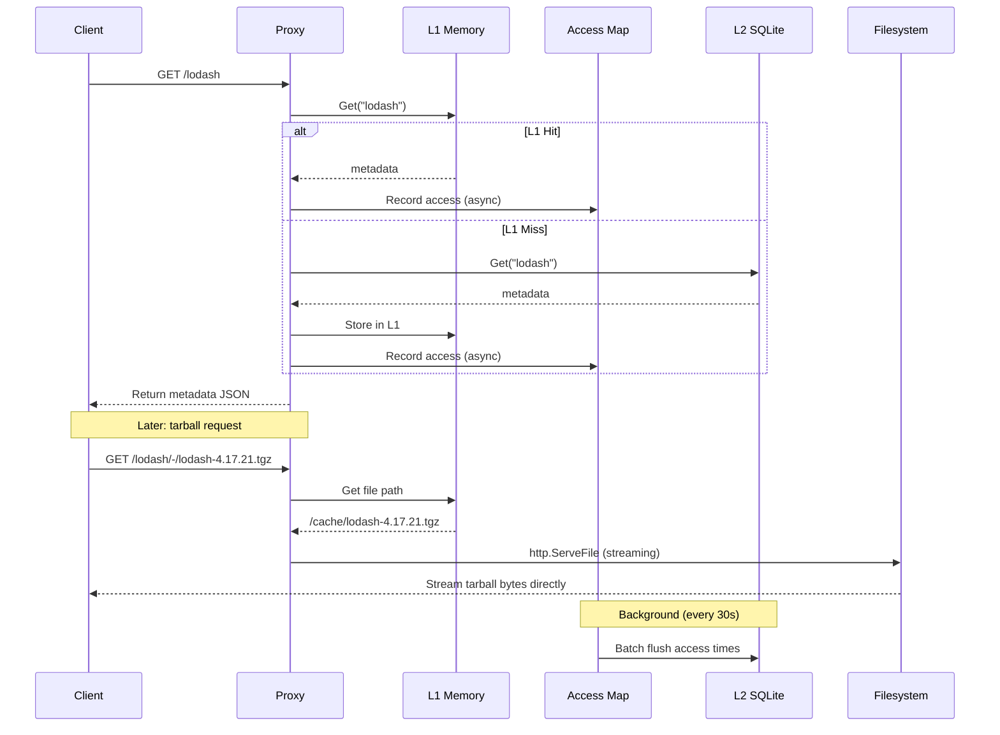

# Request path

These are the diagrams from the SQLite performance plan. They show the intended cache path: metadata in memory, SQLite as the durable index, tarball bytes streamed from disk.

The running `ncp` binary still leaves the L1 wrapper off unless `EnableL1Cache` is set. See `docs/narrative.yaml`.

## Architecture

## Request flow

